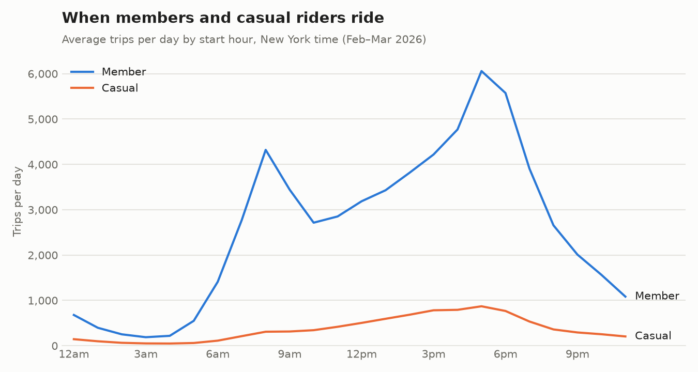
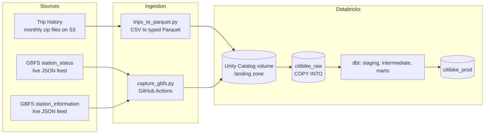
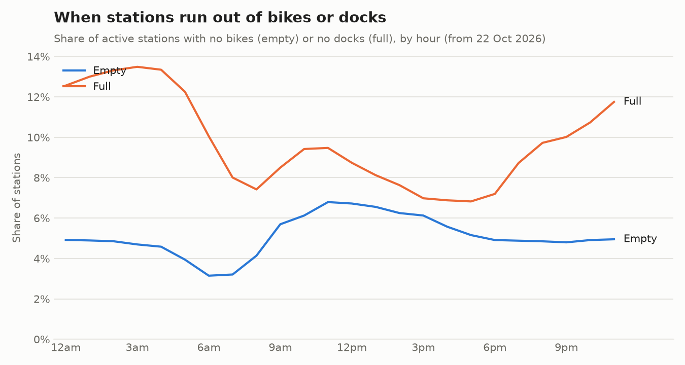

# Citi Bike Lab

An end-to-end analytics pipeline on public NYC Citi Bike data: scheduled ingestion from a live API and monthly file drops, a cloud lakehouse, and a tested, documented dbt project modeling trips and station availability.

> **Status:** the pipeline ran continuously from October to November 2026 and is now paused as of 11/10/2026 (workflows disabled, credentials revoked). The code, models and tests are complete for the scope below; see [Roadmap](#roadmap) for what's next.



---

## Architecture



| Layer | Tools |
|---|---|
| Ingestion | Python (`requests`, `pyarrow`, Databricks SDK) |
| Scheduling | GitHub Actions; cron-job.org triggering hourly runs via the GitHub API |
| Storage | Databricks Free Edition: Unity Catalog volume (landing), Delta tables |
| Loading | `COPY INTO` (idempotent: already-loaded files are skipped) |
| Transformation | dbt Core with `dbt-databricks`, `dbt_utils` |
| Environments | `citibike_dev` (local development) and `citibike_prod` (built only by CI) |

## Data sources and cadence

| Source | What it contains | Cadence | Format |
|---|---|---|---|
| [Citi Bike trip histories](https://citibikenyc.com/system-data) | One row per trip: times, start and end stations, bike type, member or casual | Monthly | Zipped CSV |
| [GBFS](https://github.com/MobilityData/gbfs) `station_status` | Bikes and docks available at every station | Captured hourly | JSON |
| GBFS `station_information` | Station names, codes, coordinates, capacity | Captured daily | JSON |

The live feed only describes the present, so station history exists only from when capture began. That's why continuous capture mattered more than capture frequency.

## Pipeline

**Hourly:** a GitHub Actions workflow captures `station_status`, compresses it, and uploads it to the landing volume in `feed=.../date=...` partitions. GitHub's built-in scheduler proved unreliable for this (see [Data quality](#data-quality)), so cron-job.org triggers the workflow through the GitHub API instead.

**Daily:** a second workflow
1. runs `COPY INTO` for all raw tables (safe to re-run: only new files load),
2. runs `dbt source freshness`,
3. runs `dbt build` against the **prod** target, so every model is built and tested in dependency order.

**Monthly:** trip files are downloaded, converted to Parquet with explicit column types (station codes forced to text) and load metadata, uploaded, and loaded by the same `COPY INTO`. The fact table then processes only the new month incrementally.

## Data model


| Layer | Models | Purpose |
|---|---|---|
| Staging (views) | `stg_trips`, `stg_station_status`, `stg_station_information` | One-to-one with sources: typing, renaming, cleaning, flattening nested JSON |
| Intermediate | `int_trip_station_sightings` | Every station seen in trip history, with first and last seen dates |
| Marts (tables) | `dim_stations`, `fct_trips` | Conformed station dimension and trip fact table |

Key design decisions:

- **UTC for storage and calculation, local time for reporting.** Trip files record New York local time with no time zone. Staging converts to UTC so durations stay correct across daylight-saving changes, and keeps local time for "what happens at 8am" analysis.
- **Station codes are text.** Codes such as `5805.10` look numeric; reading them as numbers silently turns them into `5805.1` and breaks joins. Types are set explicitly in Parquet rather than inferred.
- **A conformed station dimension.** `dim_stations` combines the live feed (current capacity and coordinates) with trip history (stations since retired). Feed values win where both exist.
- **Incremental fact table.** `fct_trips` merges on `ride_id` using the load timestamp as its watermark, not the trip date, so republished or late files are still picked up.
- **Flags, not filters.** Trips with no end station are kept and flagged; marts and reports decide what to exclude.
- **Project variable for known history.** `station_status_reliable_from_utc` records when reliable hourly capture began, so completeness checks monitor the right period.

## Data quality

Tests run on every build: uniqueness and not-null keys, composite keys (`dbt_utils.unique_combination_of_columns`), accepted values, relationships between facts and dimensions, and custom tests for row-count reconciliation, negative trip durations and hourly snapshot completeness.

Findings worth highlighting:

- **Scheduler reliability.** GitHub Actions' hourly schedule ran only 5 times in the first ~25 hours, at irregular intervals. Moving the trigger to cron-job.org (calling the `workflow_dispatch` API) produced near-hourly runs. A completeness test now flags missing hours, with warn and error thresholds.
- **History can't be backfilled.** Hourly capture is reliable only from 2026-10-22 00:00 UTC; earlier hours have gaps. This is recorded as a project variable rather than hidden.
- **Retired stations.** 73 stations used in February 2026 trips no longer appear in the live feed, so they have no capacity or feed ID. 314 current feed stations had no February trips (new, inactive or quiet in winter).
- **No rider ID.** Trip files can't be linked to individual riders, so analysis is by rider type (member or casual) and trip behavior, not by customer.
- **Row-count reconciliation** at each stage: February 2026 (1,219,444 trips) and March 2026 (2,945,753 trips) match exactly from CSV line counts through Parquet, raw tables and the fact table.



## Repository layout

```
citibike-lab/
├── .github/
│   ├── workflows/        # hourly capture, daily capture, daily load and build
│   └── dbt/profiles.yml  # CI profile (prod target, values from GitHub secrets)
├── loaders/              # capture, Parquet conversion, volume upload, COPY INTO
├── citibike/             # dbt project
│   ├── models/
│   │   ├── staging/
│   │   ├── intermediate/
│   │   └── marts/
│   ├── macros/           # e.g. haversine_km
│   └── tests/            # custom data tests
├── requirements-capture.txt
├── requirements-transform.txt
└── .env.example
```

## Running it

1. Create a Python virtual environment and install `requirements-transform.txt`.
2. Copy `.env.example` to `.env` and fill in your Databricks host, HTTP path and token.
3. Create the `citibike_raw` schema and `landing` volume in Databricks.
4. Capture and upload station data: `python loaders/capture_gbfs.py`, then `python loaders/upload_to_volume.py --local data/landing --volume /Volumes/workspace/citibike_raw/landing/gbfs --pattern "*.json.gz"`.
5. Load: `python loaders/load_raw.py`.
6. Transform and test: `cd citibike`, `dbt deps`, `dbt build`.

For scheduled runs, add the Databricks values as GitHub repository secrets and enable the workflows.

## Roadmap

- Reporting marts and Tableau Public dashboards: a "week in the life" station map, an operations overview, and rider and trip behavior
- Hourly station availability mart with a coverage flag for missing hours
- Weather (Open-Meteo) as a second source, joined at the hourly grain
- CI on pull requests: `dbt build` against a temporary schema before merging
- Estimated revenue from a pricing seed with effective dates

## Data attribution

Trip and station data are published by Citi Bike under its data use policy (see [System Data](https://citibikenyc.com/system-data)). This project is non-commercial.
